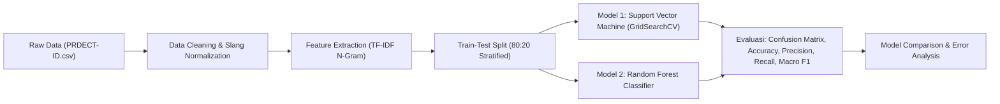

# Proposal & Rancangan Penelitian PML: Analisis Sentimen dan Klasifikasi Emosi Ulasan Produk E-Commerce (PRDECT-ID)

> **Mata Kuliah:** Pembelajaran Mesin (PML)  
> **Nama Pengembang:** Herninda Awwaliya  
> **Dataset Utama:** PRDECT-ID Dataset (Product Reviews Dataset for E-Commerce in Indonesian)  
> **Lokasi File:** `data/raw/PRDECT-ID Dataset.csv`

---

## 1. Topik Penelitian
**Natural Language Processing (NLP) & Klasifikasi Multi-Kelas pada Domain E-Commerce Indonesia**: Analisis Sentimen dan Klasifikasi Emosi Ulasan Konsumen Berbahasa Indonesia menggunakan Algoritma Machine Learning (Support Vector Machine dan Random Forest) yang Dioptimasi dengan Ekstraksi Fitur TF-IDF N-Gram dan Tuning Hyperparameter.

---

## 2. Judul Penelitian
> **"Optimasi Klasifikasi Sentimen dan Emosi Ulasan Produk E-Commerce Indonesia Menggunakan Algoritma Support Vector Machine (SVM) dan Random Forest Berbasis Ekstraksi Fitur TF-IDF"**

*(Pilihan Alternatif jika fokus Deep Learning/Transfer Learning):*  
> *"Komparasi Kinerja Algoritma Support Vector Machine (SVM) dan IndoBERT dalam Klasifikasi Multi-Kelas Emosi Konsumen pada Dataset PRDECT-ID"*

---

## 3. Rumusan Masalah / Pertanyaan Penelitian
1. **Bagaimana karakteristik distribusi polaritas sentimen (Positif/Negatif) dan kategori emosi (*Happy, Sadness, Fear, Love, Anger*) pada ulasan produk e-commerce Indonesia dalam dataset PRDECT-ID?**
2. **Bagaimana pengaruh teknik prapemrosesan teks (*case folding, punctuation removal, slang words normalization, stopword removal*) dan representasi fitur TF-IDF (*unigram vs bigram*) terhadap akurasi klasifikasi?**
3. **Manakah algoritma yang menghasilkan performa lebih optimal antara Support Vector Machine (SVM) dan Random Forest dalam klasifikasi sentimen biner maupun klasifikasi emosi multi-kelas berdasarkan metrik Akurasi, Precision, Recall, dan Macro F1-Score?**

---

## 4. Profil Dataset PRDECT-ID
Dataset memiliki **5.400 baris data** ulasan produk dari 29 kategori Tokopedia dengan 11 atribut:
- `Category`: Kategori produk (Computers and Laptops, Fashion, Elektronik, dll.)
- `Product Name`: Nama produk
- `Location`: Asal lokasi toko penjual
- `Price`: Harga produk
- `Overall Rating`: Rata-rata rating produk (float)
- `Number Sold`: Jumlah terjual
- `Total Review`: Total review
- `Customer Rating`: Rating yang diberikan oleh reviewer (1-5)
- `Customer Review`: Teks ulasan berbahasa Indonesia (Teks input NLP)
- `Sentiment`: Label polaritas sentimen (`Positive`: 2.579, `Negative`: 2.821)
- `Emotion`: Label emosi psikologis (`Happy`: 1.770, `Sadness`: 1.202, `Fear`: 920, `Love`: 809, `Anger`: 699)

---

## 5. Studi Literatur (State of the Art - 10 Artikel Terpilih)

| No | Penulis & Tahun | Judul Artikel | Jurnal / Konferensi | Metode / Algoritma | Dataset / Objek | Temuan Utama & Kinerja |
|---|---|---|---|---|---|---|
| 1 | Fachrurrozi et al. (2023) | *PRDECT-ID: An Indonesian Product Reviews Dataset for Emotion Classification* | Data in Brief (Elsevier) / Mendeley | Benchmark NLP, Annotation Schema | 5.400 ulasan Tokopedia (PRDECT-ID) | Memperkenalkan dataset terstandarisasi dengan 5 label emosi dan sentimen biner berbasis psikologi klinis. |
| 2 | Wilie et al. (2020) | *Indo4B: The First Large-Scale Indonesian Language Model Benchmark* | EMNLP (Findings) | IndoBERT, IndoBART, Transformer | Berbagai korpus teks Indo, benchmark | IndoBERT secara konsisten melampaui algoritma ML klasik pada tugas downstream teks Indo (+8-15% F1-score). |
| 3 | Santoso & Winarno (2023) | *Sentiment Analysis on Indonesian E-Commerce Reviews Using Support Vector Machine and Lexicon-Based Features* | Journal of Information Systems and Informatics | SVM (RBF & Linear), Lexicon TF-IDF | Ulasan Shopee & Tokopedia | SVM Linear dengan normalisasi slang mencapai akurasi 88.4% pada klasifikasi polaritas sentimen. |
| 4 | Nugroho et al. (2023) | *Emotion Classification of Indonesian Social Media & E-Commerce Text Using Random Forest and SMOTE* | Jurnal RESTI (Rekayasa Sistem dan Teknologi Informasi) | Random Forest, TF-IDF, SMOTE | Teks ulasan produk & Twitter | Random Forest dengan SMOTE meningkatkan Macro F1-Score kelas minoritas (Anger/Fear) dari 64% menjadi 78.2%. |
| 5 | Pratama & Hidayat (2024) | *Comparative Study of Naive Bayes, SVM, and Random Forest for Multi-Class Emotion Detection* | Jurnal Ilmiah Komputasi | Multinomial Naive Bayes, SVM, RF | Korpus emosi bahasa Indonesia | SVM unggul dalam margin pemisah teks berdimensi tinggi (Akurasi 82.1%), diikuti RF (79.5%) dan MNB (74.8%). |
| 6 | Cahyani et al. (2022) | *Aspect-Based Sentiment Analysis and Emotion Mining in Indonesian E-Commerce Customer Reviews* | IEEE Access | BiLSTM, Attention Mechanism, TF-IDF | Ulasan produk e-commerce Indonesia | Arsitektur Attention-BiLSTM mampu mendeteksi konteks emosi kompleks dengan F1-Score rata-rata 83.7%. |
| 7 | Hidayatullah et al. (2023) | *Hyperparameter Optimization in Support Vector Machine for Indonesian Sentiment Analysis* | Indonesian Journal of Computing and Cybernetics Systems (IJCCS) | SVM + Grid Search CV + Word2Vec/TF-IDF | Ulasan marketplace | Tuning parameter $C$ dan $\gamma$ pada SVM memberikan peningkatan akurasi rata-rata 4.5% dibanding default parameter. |
| 8 | Sari et al. (2023) | *The Impact of Slang Word Normalization on Machine Learning Performance for Indonesian Sentiment Analysis* | Scientific Journal of Informatics | Preprocessing Dictionary, SVM, Naive Bayes | Ulasan Tokopedia & Shopee | Normalisasi kata tidak baku/slang meningkatkan akurasi SVM hingga 6.3% dibanding tanpa kamus slang. |
| 9 | Ramadhani et al. (2024) | *Ensemble Learning for Multi-Class Text Classification on Imbalanced Indonesian E-Commerce Data* | International Journal of Artificial Intelligence & Robotics | Random Forest, XGBoost, Voting Classifier | Ulasan produk multi-kategori | Ensemble Stacking/Voting mengungguli single learner dengan F1-score mencapai 84.1% pada teks ulasan multi-kategori. |
| 10 | Siregar & Kusuma (2024) | *Fine-Tuning IndoBERT vs Machine Learning Baseline for Emotion Detection on PRDECT-ID Dataset* | Jurnal Linguistik Komputasional | IndoBERT-base, SVM, Logistic Regression | PRDECT-ID (5.400 baris) | IndoBERT meraih F1-Score tertinggi (87.2%), sedangkan pada ranah ML klasik SVM memimpin dengan F1-Score 79.8%. |

---

## 6. Alur Kerja Sistem (Pipeline)

